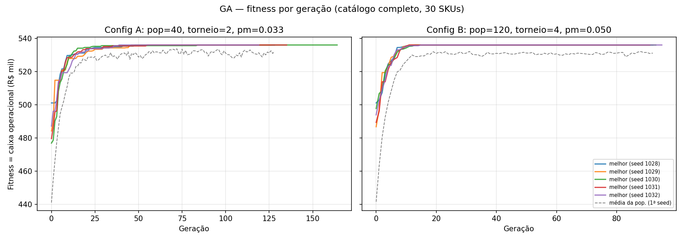

# Questão 1 — Operação Caixa 90 (Grupo G01)

Execução (na raiz do projeto): `python questao_01/main.py --modo completo` (cerca de 15 s). Os dados são lidos de `data/` e as saídas vão para `questao_01/saida/`. Todas as opções: `python questao_01/main.py --help` (ver também o `README.md` da raiz).

| Arquivo | Conteúdo |
|---|---|
| `modelo.py` | Premissas, leitura dos dados, preços permitidos, função de avaliação e `medir()` |
| `brute_force.py` | (A) Brute Force ingênuo e vetorizado |
| `genetic_algorithm.py` | (B) Algoritmo Genético |
| `greedy.py` | (C) Greedy de incentivos |
| `escalabilidade.py` | Medição dos 3 algoritmos em entradas pequena, média e grande |
| `main.py` | Linha de comando, integração do fluxo, tabelas, gráficos, medições e manifesto |

## 1. Nesta questão utilizamos 3 algoritmos

| Etapa | Algoritmo | Papel | Entrada | Saída |
|---|---|---|---|---|
| A | **Brute Force** | Ótimo exato de um subconjunto de 6 SKUs (benchmark) | preços permitidos (seed_base) | política ótima + fitness ótimo |
| B | **Algoritmo Genético** | 1) roda no **mesmo** subconjunto e é comparado ao ótimo do BF (gap %); 2) roda no catálogo completo | preços permitidos + fitness do BF (validação) | política de preços dos 30 SKUs |
| C | **Greedy** | Distribui o orçamento promocional **sobre a política produzida pelo GA** | política do GA + orçamento | incentivo por SKU + resultado final |

```
config + catálogo ──► preços permitidos (seed_base=28, piso de margem, regra anti-desconto)
        │
        ├─► (A) Brute Force [6 SKUs, 51.450 combinações] ──ótimo──┐
        │                                                          ▼
        ├─► (B1) GA no mesmo subconjunto ──────────────► gap % vs ótimo (validação)
        │
        └─► (B2) GA no catálogo completo [seed_final=1028] ──política──► (C) Greedy ──► resultado final
```

Os três algoritmos compartilham a **mesma função de avaliação** (`avaliar_vetorizado`), então o ótimo do BF e o fitness do GA são diretamente comparáveis, e o Greedy parte exatamente dos preços e das vendas calculados pelo GA.

## 2. Modelo econômico e premissas

Para o SKU *j* com multiplicador de preço *m* (p = m · preco_atual):

- **Demanda**: `q = min(estoque, demanda_base · m^(−elasticidade) · (m / m̄_categoria)^(−γ))`, γ = 0,5.
  O segundo termo é **canibalização**: um SKU mais barato que os pares da categoria rouba participação. Isso acopla os SKUs (o problema deixa de ser separável) e justifica uma metaheurística.
- **Caixa operacional** (fitness): `Σ q·[p(1−taxa_marketplace) − custo_logistico − custo_unitario] − Σ (estoque − q)·custo_unitario·taxa_armazenagem`
  - Usamos a **contribuição**, não a receita: o custo econômico precisa ser reposto; sem isso, liquidar abaixo do custo pareceria lucrativo. A escala confirma a escolha: a meta (R$ 362 mil) é próxima da contribuição a preço atual, enquanto a receita líquida passa de R$ 2,4 milhões.
  - **Armazenagem do estoque que sobra**: 4,5% do custo em 90 dias, +4,5% para itens com idade ≥ 180 dias. É onde `idade_estoque_dias` entra no caixa.
- **Restrições**
  - **Piso de margem** 8,48% (rígido): níveis abaixo do piso saem do conjunto permitido. SKUs sem nenhum nível viável ficam **fora da campanha**: Q1-002, Q1-012 e Q1-024.
  - **Anti-desconto indiscriminado**: no máximo 30% dos SKUs com preço abaixo do atual (penalidade no fitness); desconto profundo (m < 0,90) só para estoque com 180 dias ou mais.
- **Preços permitidos (seed_base = 28)**: cada SKU sorteia de 4 a 7 dos 7 níveis do config (o nível 1,00 sempre entra); depois aplicam-se os filtros acima. Ver `saida/00_precos_permitidos.csv`.

## 3. (A) Brute Force × (B) GA no subconjunto

O subconjunto é escolhido **automaticamente** por `escolher_subconjunto` em `main.py`, e pode ser trocado com `--subconjunto`. A regra é:
- até 2 SKUs ativos por categoria, para que a canibalização atue;
- prioridade às categorias e SKUs com mais níveis de preço permitidos;
- limite de 200.000 combinações.

Na instância G01 a regra escolhe Q1-014, Q1-008 (Beleza), Q1-005, Q1-011 (Casa), Q1-003 e Q1-015 (Moda). O espaço tem 7·6·7·5·7·5 = **51.450 combinações**.

| | Brute Force | GA (10 execuções, seeds 28–37) |
|---|---|---|
| Fitness | R$ 108.267,60 (ótimo) | R$ 108.267,60 em **10/10** execuções |
| Gap | — | **0,00%** (médio e máximo) |
| Política | 1,10 em todos, exceto Q1-011 a 1,00 | idêntica |
| Avaliações | 51.450 | 1.290 a 1.710 (**≈ 3%** do espaço) |
| Tempo | 0,038 s (vetorizado) / 4,63 s (ingênuo) | ≈ 0,06 s |

Detalhes por execução: `saida/01_bruteforce_vs_ga.csv` e `01b_politicas_subconjunto.csv`.

## 4. (B) GA no catálogo completo

**Codificação.** Vetor de 30 inteiros; o gene *j* é o índice do preço permitido do SKU *j*. Todo cromossomo é viável quanto a margem e estoque por construção; o limite de descontos é tratado por penalidade.

| Parâmetro | Escolha | Justificativa |
|---|---|---|
| População | A = 40 · B = 120 | Comparar o custo de diversidade com a velocidade de convergência |
| Inicialização | aleatória + 1 indivíduo "preço atual" | Garante um ponto de partida viável e realista |
| Seleção | Torneio (A: k = 2, B: k = 4) | Não depende de escala e funciona com fitness negativo ou penalizado; k controla a pressão seletiva |
| Crossover | Uniforme, p = 0,9 | Os SKUs não têm ordem natural; o crossover de 1 ponto criaria viés posicional |
| Mutação | Troca para outro preço permitido; p = 1/n (A) e 1,5/n (B) | Cerca de 1 gene mutado por filho, o que preserva a estrutura boa |
| Elitismo | 1 (A) e 2 (B) | O melhor fitness nunca piora |
| Parada | 500 gerações **ou** 80 gerações sem melhora | Encerra depois da convergência, sem gerações fixas desperdiçadas |

**Comparação das configurações** (5 execuções cada, seeds 1028–1032):

| Config | Melhor | Média | Desvio | Gerações | Avaliações | Tempo médio | Memória (pico) |
|---|---|---|---|---|---|---|---|
| A: pop = 40, k = 2, pm = 1/n | R$ 536.125,91 | R$ 536.125,91 | 0 | 134 | 5.282 | 0,15 s | 242 KiB |
| B: pop = 120, k = 4, pm = 1,5/n | R$ 536.125,91 | R$ 536.125,91 | 0 | 92 | 11.023 | 0,11 s | 498 KiB |

**Convergência** (`fig1`, `fig2`). As duas configurações chegam ao mesmo ótimo em todas as execuções.
- **B** converge em cerca de 10–15 gerações, graças à maior pressão seletiva e à população maior. Gasta o dobro de avaliações e o dobro de memória, porque a memória é O(P·n).
- **A** precisa de 40–80 gerações, mas usa metade das avaliações.

O tempo de B ficou um pouco menor porque ela para antes e a avaliação é vetorizada por geração. Assim, o custo por geração cresce menos que linearmente com P. Para este tamanho de instância, **A é a configuração mais eficiente em avaliações; B é a mais rápida em gerações**.



## 5. (C) Greedy de incentivos

**Opções de incentivo por SKU** (no máximo uma por SKU):

| Opção | Custo por unidade | Desconto percebido pelo cliente |
|---|---|---|
| Cupom 5% e 10% | 100% do valor | 100% |
| Cashback 5% e 10% | 65% do valor (35% nunca é resgatado) | 75% |
| Frete subsidiado | custo_logistico | 130% (efeito "frete grátis") |

O incentivo altera a demanda pela elasticidade, respeita o estoque e precisa manter o piso de margem.

**Regra.** Mochila de múltipla escolha resolvida com *upgrades* gulosos. A cada passo, escolhe-se o upgrade de maior **Δganho de contribuição / Δreal investido**, desde que caiba no orçamento. A regra principal exige razão ≥ 1, ou seja, **cada real investido precisa voltar como pelo menos 1 real de caixa**. Como o dinheiro vai para a dívida, um incentivo que reduz o caixa não se justifica.

**Resultado da regra principal.** Só **1 incentivo** paga a si mesmo: frete subsidiado no Q1-001 (razão 1,01). Ele custa R$ 3.642, leva o SKU a vender todo o estoque (304 → 332 unidades) e acrescenta +R$ 31,64 líquidos ao caixa.

| SKU | Incentivo | Custo | Unidades antes → depois | Caixa antes → depois |
|---|---|---|---|---|
| Q1-001 | frete subsidiado | R$ 3.642,04 | 304,3 → 332,0 | R$ 38.332,32 → R$ 38.363,95 |
| demais 26 ativos | — | 0 | sem mudança | sem mudança |

A tabela completa dos 30 SKUs está em `saida/04_antes_depois_greedy.csv`.

**Cenário de sensibilidade: "verba carimbada"** (razão > 0, gastando todo o orçamento). Esse seria o caso se a verba não pudesse voltar para a dívida, por exemplo uma verba de fornecedor.
- São usados R$ 128.319 em 17 SKUs, com +346 unidades vendidas e +R$ 62,4 mil de contribuição bruta.
- Mas o **caixa líquido cai de R$ 536,1 mil para R$ 470,3 mil**.
- Detalhes: `03b_*` e `04b_*`.

O cenário mostra por que a regra principal é a correta para o objetivo da questão.

## 6. Resultado final (GA + Greedy)

| Indicador | Valor |
|---|---|
| Caixa a preço atual (sem otimização) | R$ 382.701,46 |
| Caixa com a política do GA | R$ 536.125,91 |
| **Caixa final (GA + Greedy)** | **R$ 536.157,55** |
| Meta de caixa 90 dias | R$ 362.210,17 → **ATINGIDA** |
| **Folga** | **+R$ 173.947,38** |
| Cobertura da dívida de 90 dias (R$ 355.454) | **150,8%** |
| Receita bruta | R$ 2.770.341,69 |
| Margem de contribuição média | 21,3% (piso: 8,48%) |
| Unidades vendidas / estoque inicial | 3.138 / 4.819 (65%) |
| Estoque remanescente | 1.681 unidades (R$ 784,8 mil a custo) |
| Custo de armazenagem do remanescente | R$ 55.067,82 (já descontado do caixa) |
| Orçamento promocional usado | R$ 3.642,04 de R$ 129.986,30 (2,8%) |
| Política de preços | 26 SKUs a +5% ou +10%, 1 mantido (Q1-011), 0 com desconto, 3 fora da campanha |

**Leitura.** Com elasticidades entre 0,8 e 2,1 e margens de contribuição de 9% a 39% (SKUs ativos), cada ponto de desconto destrói mais contribuição do que o volume extra repõe. Por isso o ótimo é **subir preço** onde há espaço, e a regra anti-desconto nem chega a ficar ativa.

O custo dessa política é estoque parado: sobram 35% das unidades, com R$ 55 mil de armazenagem. Esse estoque, em especial os itens com mais de 180 dias como Q1-014, Q1-021 e Q1-013, é o candidato natural a uma segunda onda de liquidação **depois** que a dívida estiver paga.

Os 3 SKUs fora da campanha ficaram de fora porque o sorteio da seed não incluiu um nível de preço que atinja o piso. O Q1-002, por exemplo, atingiria o piso a 1,10, mas esse nível não foi sorteado.

## 7. Complexidade (Big O) e escalabilidade

A análise completa está em [`BIG_O.md`](../BIG_O.md): tempo, memória, significado das variáveis, trecho do código que domina, limite de viabilidade e alternativa. As medições em três tamanhos estão em `saida/06_escalabilidade.csv` e `fig4`. Resumo:

| Algoritmo | Tempo | Memória | Medido (pequena → média → grande) |
|---|---|---|---|
| Brute Force (vetorizado) | O(Π L_j · (k + C)) | O(min(Π L_j, B) · k) | 1.470 → 10.290 → 51.450 combinações: 0,001 → 0,004 → 0,026 s · 0,5 → 3,9 → 23 MiB |
| GA (config A) | O(G · P · (t + n + C)) | O(P · n + G) | 10 → 30 → 90 SKUs: 0,09 → 0,14 → 0,24 s · 141 → 234 → 541 KiB |
| Greedy (heap) | O(n·K + S·(K + log(n·K))) | O(n · K) | 10 → 30 → 90 SKUs: 0,012 → 0,039 → 0,120 s · 47 → 92 → 219 KiB |

**Quando o Brute Force deixa de ser viável.** O catálogo inteiro teria Π L_j ≈ 1,5 × 10¹² combinações. Pelas taxas medidas, isso levaria cerca de 8,9 dias na versão vetorizada e cerca de 4,6 anos na ingênua. Por isso o GA é a alternativa usada para o catálogo completo.

## 8. Cenário-surpresa

Toda alteração da defesa técnica é feita por parâmetro, sem mexer no código:
- `--meta-fator`;
- `--logistica-fator`;
- `--orcamento-fator`;
- `--remover-sku`;
- `--ga-pop`, `--ga-mutacao`, `--ga-torneio`, `--ga-elitismo` e `--ga-geracoes`;
- `--seed`.

`python cenarios_surpresa.py` roda os casos do enunciado e consolida os resultados em `cenarios_surpresa/resumo.md`:

| Cenário | Caixa final | Meta | Folga | SKUs fora da campanha |
|---|---|---|---|---|
| Base | R$ 536,2 mil | R$ 362,2 mil | +R$ 173,9 mil | 3 |
| Meta +10% | R$ 536,2 mil | R$ 398,4 mil | +R$ 137,7 mil | 3 |
| Logística +15% | R$ 502,3 mil | R$ 362,2 mil | +R$ 140,0 mil | 6 |
| Orçamento −25% | R$ 536,2 mil | R$ 362,2 mil | +R$ 173,9 mil | 3 |
| Q1-023 indisponível | R$ 458,5 mil | R$ 362,2 mil | +R$ 96,3 mil | 3 |
| GA com população 80 e mutação 0,10 | R$ 536,2 mil | R$ 362,2 mil | +R$ 173,9 mil | 3 |
| Combinado (meta +10%, logística +15%, orçamento −25%) | R$ 502,3 mil | R$ 398,4 mil | +R$ 103,8 mil | 6 |

**Leituras.**
- **Orçamento −25%** não muda nada: a regra principal usa só R$ 3,6 mil dos R$ 130 mil.
- **Logística +15%** derruba mais 3 SKUs abaixo do piso de margem.
- **Q1-023 indisponível** é a maior perda. Ele é o SKU que mais gera caixa (R$ 73,7 mil).
- **Mudar a configuração do GA** chega ao mesmo ótimo.

## 9. Otimização de código demonstrada (antes/depois)

| Trecho | Antes | Depois | Speedup | Memória |
|---|---|---|---|---|
| Brute Force (51.450 combinações) | `itertools.product` + avaliação em Python puro com dicionários | Produto cartesiano por `np.unravel_index` e avaliação matricial em blocos | **≈ 122×** (4,63 s → 0,038 s) | 35 KiB → 23,2 MiB |
| Fitness de 1 geração do GA (120 × 30) | laço Python por indivíduo | `avaliar_vetorizado` (matriz P × n) | **≈ 15×** (4,47 ms → 0,30 ms) | — |

As duas versões produzem resultados idênticos, verificados com `assert` no código.

A otimização do BF é uma **troca tempo × memória**: a versão vetorizada materializa até B combinações por vez. O bloco B limita esse uso e mantém a memória em O(B·k) em vez de O(Lᵏ·k).

## 10. Limitações

- A elasticidade é tratada como constante para uma faixa de ±20%. A canibalização (γ) e as taxas de armazenagem e de percepção dos incentivos são premissas do grupo, explícitas e ajustáveis no topo de `modelo.py`.
- O efeito do incentivo no Greedy usa o preço de tabela (fixado pelo GA) para a canibalização, o que torna os SKUs separáveis nessa etapa. Como o único incentivo alocado altera apenas 28 unidades do Q1-001, o efeito omitido sobre o Q1-008 e o Q1-014 (mesma categoria) é desprezível.
