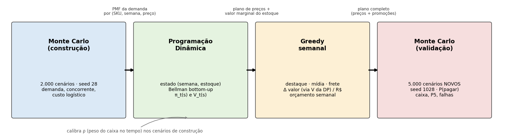
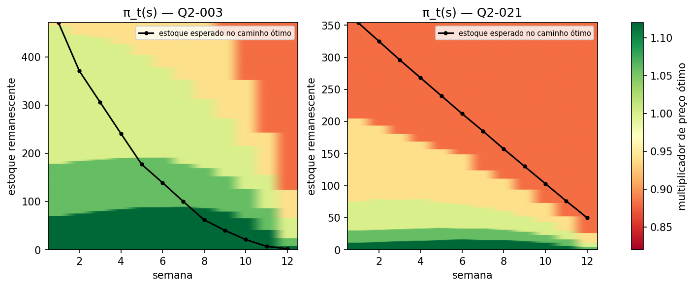
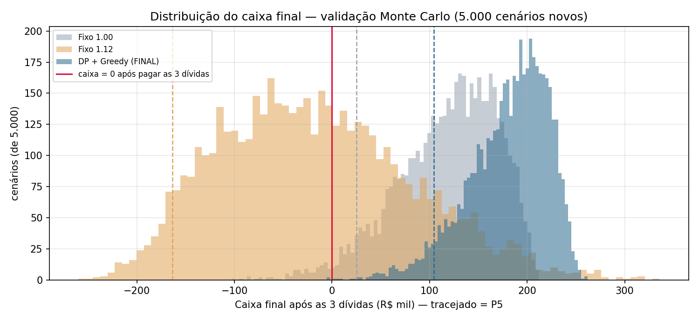
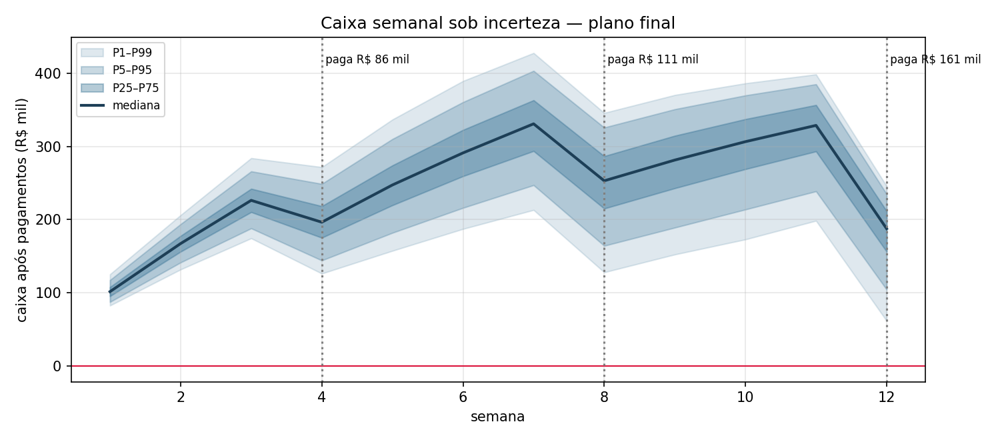
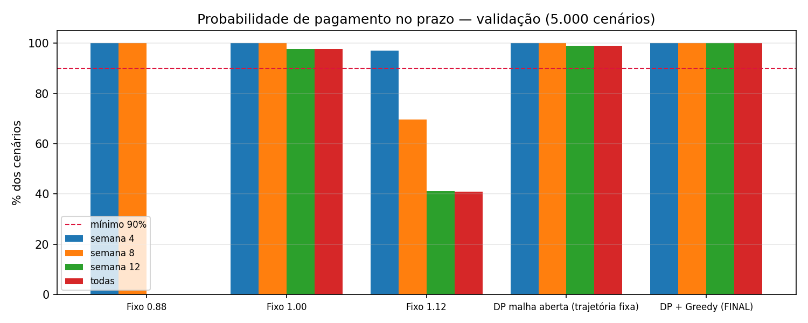
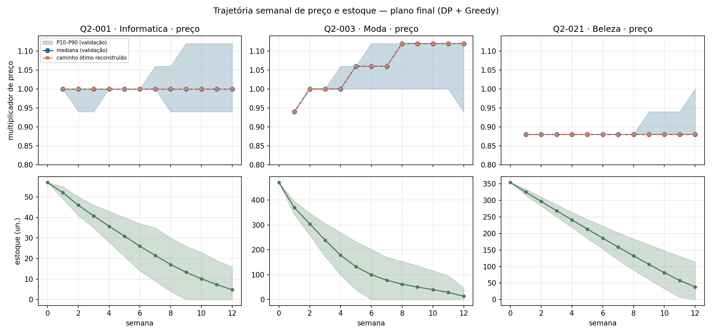

# Questão 2 — Plano de Sobrevivência em 12 Semanas (Grupo G01)

Execução (na raiz do projeto): `python questao_02/main.py --cenarios 5000` (cerca de 30 s). Os dados são lidos de `data/` e as saídas vão para `questao_02/saida/`. Todas as opções: `python questao_02/main.py --help` (ver também o `README.md` da raiz).

| Arquivo | Conteúdo |
|---|---|
| `modelo.py` | Premissas, leitura dos dados, geração de cenários (3 fontes de incerteza) e `medir()` |
| `monte_carlo.py` | (A) Estimação na construção e simulação na validação |
| `dynamic_programming.py` | (B) Bellman Bottom-Up, Top-Down com memo e reconstrução do caminho |
| `greedy.py` | (C) Alocação semanal de destaque, mídia e frete promocional |
| `main.py` | Linha de comando, integração, calibração, figuras, estresse, escalabilidade e manifesto |

## 1. Nesta questão utilizamos 3 algoritmos

| Etapa | Algoritmo | Papel | Recebe | Entrega |
|---|---|---|---|---|
| A | **Monte Carlo** | 2.000 cenários de construção (seed 28): distribuição da demanda e do caixa por SKU, semana e preço. No fim, 5.000 cenários **novos** (seed 1028) para validar o plano | config + catálogo | PMFs de demanda e amostras; probabilidades de pagamento |
| B | **Programação Dinâmica** | Escolhe o preço de cada semana em função de (semana, estoque) | PMFs do MC | política π_t(s), valor V_t(s) e caminho ótimo |
| C | **Greedy** | Segue o plano da DP e decide, a cada semana, quais SKUs recebem destaque, mídia ou frete promocional | π e V da DP + amostras do MC | plano promocional semanal |

A integração acontece em quatro pontos:

- **MC → DP.** As PMFs da demanda estimadas pelo MC são a "transição" da DP.
- **Calibração.** O MC de construção também escolhe ρ, o peso do caixa no tempo usado pela DP.
- **DP → Greedy.** O Greedy segue π_t(s) e mede o ganho de cada promoção com o V_{t+1} da DP. Com isso, uma venda antecipada só vale se superar o valor de guardar aquela unidade.
- **Plano → MC.** O plano completo (π_t(s) + promoções) volta ao MC e é testado em cenários que nunca foram usados para construí-lo.

## 2. Modelo de incerteza (Monte Carlo)

Para o SKU j na semana t com multiplicador de preço m:

- **Demanda** ~ Poisson(λ), com `λ = demanda_base · m^(−elasticidade) · fator_concorrência · ε`.
  - **Fonte 1 — demanda do consumidor:** ε é lognormal com média 1 e σ = 14,32% (do config). Metade da variância vem de um choque de mercado comum a todos os SKUs. Por isso os SKUs se movem juntos e o risco não se dilui no portfólio.
  - **Fonte 2 — preço do concorrente:** passeio aleatório lognormal com σ = 3,12% por semana (metade comum ao mercado). O fator de concorrência modela a disputa pela vitrine do marketplace (efeito *buy box*): `share(g) = 1/(1+exp(15·(g − 1,02)))`, com g = preço / preço do concorrente. O fator é normalizado para 1 no preço atual com o concorrente parado.
- **Fonte 3 — custo logístico:** multiplicador semanal comum, AR(1) com persistência 0,6 e σ = 8,18%. Representa reajuste de transportadora ou combustível, que dura algumas semanas.
- **Caixa da semana:**
  `Σ vendas · [p(1 − taxa_marketplace) − custo_logístico_t − custo_unitário] − gastos promocionais`.
  - É a mesma definição de caixa operacional da Questão 1 (contribuição).
  - Nas semanas 4, 8 e 12 a dívida é paga se houver caixa. Se não houver, o compromisso **falha** e o saldo negativo é rolado.
  - O caixa inicial é R$ 33.522,04.

**Resultado da estimação** (`saida/01_*.csv`): caixa de 12 semanas com um preço fixo para todo o catálogo.

| Nível fixo | P5 | Média | P95 |
|---|---|---|---|
| 0,82 | R$ 129 mil | R$ 132 mil | R$ 136 mil |
| 0,94 | R$ 303 mil | R$ 381 mil | R$ 413 mil |
| 1,00 | R$ 226 mil | R$ 442 mil | R$ 535 mil |
| 1,12 | R$ 62 mil | R$ 308 mil | R$ 685 mil |

Essa é a tensão da questão:
- **Desconto** dá caixa previsível, mas insuficiente para as três dívidas, que somam R$ 357 mil.
- **Preço alto** dá a maior média possível, mas uma cauda péssima. Se o concorrente baixar o preço, o SKU perde a vitrine.

## 3. Programação Dinâmica

| Elemento | Definição |
|---|---|
| **Estado** | (t, s): semana t ∈ {1..12} e estoque remanescente s ∈ {0..S_j} do SKU j |
| **Decisão** | m ∈ {0,82; 0,88; 0,94; 1,00; 1,06; 1,12} |
| **Transição** | s' = s − min(s, D), com D ~ PMF_{j,t,m} **estimada pelo Monte Carlo** |
| **Recompensa** | r_t(m) · min(s, D), com r_t(m) = w_t · [m·p0·(1 − taxa) − E_MC[logístico_t] − custo] e w_t = (1+ρ)^−(t−1) |
| **Bellman** | V_t(s) = max_m Σ_d P_{t,m}(d) · [r_t(m)·min(s,d) + V_{t+1}(s − min(s,d))] |
| **Base** | V_13(s) = 0 (estoque que sobra mantém o valor de custo) |
| **Objetivo** | V_1(S_j): contribuição ponderada esperada máxima |

**Por que a DP é resolvida por SKU.** O estado conjunto (semana, estoque dos 24 SKUs, caixa) teria cerca de 10⁵⁰ estados. A DP é decomposta por SKU, e o acoplamento pelo caixa entra de duas formas:
- pelo peso w_t, que valoriza o caixa que chega antes das dívidas;
- pelo Monte Carlo, que mede o risco conjunto.

**Calibração de ρ.** Fiz uma grade ρ ∈ {0; 0,02; 0,05; 0,10} nos 2.000 cenários de construção. O critério é a maior P(pagar as 3) e, em caso de empate, o maior caixa médio. O escolhido foi **ρ = 0,10**, com P = 100% e 1 falha em 2.000 cenários (`saida/02_*.csv`).

**Abordagem.** Uso **Bottom-Up** (t = 12 → 1, vetorizado em s e d) como solver principal. O **Top-Down com memo** é usado como prova de equivalência: os dois dão o mesmo V_1, verificado com `assert`.

**Onde ocorre a reutilização.** V_{t+1}(s') é calculado **uma única vez** e lido por todos os pares (s, m, d) que levam a s'. Por exemplo, V_{t+1}(0) é lido por todo s com demanda d ≥ s.

| Caso (`saida/04_*.csv`) | Chamadas | Subproblemas distintos | Reuso (acertos ou leituras) | Tempo |
|---|---|---|---|---|
| Top-Down **com** memo, Q2-001, 12 semanas | 74.122 | 610 | 66.088 acertos de cache | 0,05 s |
| Top-Down **com** memo, 3 semanas | 9.916 | 88 | 3.332 | 0,006 s |
| Top-Down **sem** memo, 3 semanas | **1.455.780** | — | 0 | 0,73 s |
| Bottom-Up, catálogo inteiro | — | 61.560 estados | 25,8 milhões de leituras (cerca de 419 por estado) | 1,2 s |

Sem memo, já com 3 semanas a árvore de chamadas é 147× maior. Com 12 semanas ela cresce como O((M·D)^T), o que é inviável.

**Caminho ótimo reconstruído** (`saida/03_*.csv`). O caminho segue o estoque esperado: s₁ = S, m_t = π_t(s_t), s_{t+1} = s_t − E[vendas]. Alguns SKUs:

| SKU | Semanas 1–12 | Leitura |
|---|---|---|
| Q2-003 (Moda, giro alto) | 0,94 → 1,00 → 1,06 → 1,12 | Abre competitivo e sobe o preço conforme o estoque fica escasso |
| Q2-012 (Moda, 18 semanas de estoque) | 0,88 → 0,94 → 1,00 → 1,06 | Excesso de estoque: liquida no começo e recompõe a margem depois |
| Q2-021 (Beleza, 30 semanas de estoque) | 0,88 nas 12 semanas | Muito estoque: preço competitivo o tempo todo |
| Q2-001 (Informática) | 1,00 nas 12 semanas | Já no ótimo frente ao concorrente |
| Q2-017 (Beleza) | 1,12 nas 12 semanas | Contribuição **negativa em qualquer preço** (frete R$ 21 > margem): a DP apenas minimiza a perda |

Recomendação para o Q2-017: **retirar o SKU do canal**.

O mapa π_t(s) mostra que a decisão depende de **semana e estoque** ao mesmo tempo. Com muito estoque perto do fim do horizonte o preço cai; com pouco estoque o preço sobe.

## 4. Greedy semanal (recursos promocionais)

**Recursos disponíveis** (máximo de 1 por SKU por semana; orçamento de R$ 5.999,56 por semana):

| Recurso | Custo | Efeito |
|---|---|---|
| Destaque (home) | R$ 350 por semana | +15% de demanda; no máximo 3 por semana |
| Mídia | R$ 1.200 por semana | +35% de demanda |
| Frete promocional | Empresa paga o frete do cliente (custo_logístico por unidade) | Equivale a um corte de preço desse valor (via elasticidade) |

**Regra de alocação.** A cada semana:
1. O Greedy calcula, com as amostras do MC, o ganho Δ = E[r·Q₁ + V_{t+1}(s − Q₁)] − E[r·Q₀ + V_{t+1}(s − Q₀)].
2. Ordena os candidatos pela razão **Δ / R$**.
3. Aceita enquanto a razão for ≥ 1, ou seja, enquanto o recurso se pagar.

Depois atualiza o estoque esperado e reconsulta o plano da DP na semana seguinte.

**Resultado** (`saida/05_*.csv`):
- **15 destaques** nas semanas 1 a 6, para Q2-004, Q2-012 e Q2-023, com gasto de R$ 5.250 de R$ 72 mil disponíveis.
- **Da semana 7 em diante nenhum recurso se paga.** O valor de guardar o estoque (V da DP) supera o ganho de vender antes.

**Sensibilidade: orçamento carimbado** (gastar onde houver qualquer ganho).
- São 142 alocações e R$ 71 mil gastos.
- A P(pagar as 3) cai de 99,94% para 99,64%, e o caixa médio cai R$ 50,5 mil.

Isso confirma a regra principal.

## 5. Validação: 5.000 cenários novos (cenários com seed 1028; vendas sorteadas com seed 1035)

| Política (`saida/06_*.csv`) | P sem. 4 | P sem. 8 | P sem. 12 | **P todas** | Caixa final médio | **P5** | Margem | Estoque final |
|---|---|---|---|---|---|---|---|---|
| Fixo 0,82 | 100% | 0% | 0% | 0% | −R$ 191,7 mil | −R$ 202,6 mil | 6,1% | 149 |
| Fixo 0,88 | 100% | 100% | 0% | 0% | −R$ 57,5 mil | −R$ 71,1 mil | 11,7% | 320 |
| Fixo 1,00 (preço atual) | 100% | 100% | 97,8% | 97,8% | R$ 118,7 mil | R$ 25,1 mil | 20,7% | 1.516 |
| Fixo 1,12 | 97,2% | 69,5% | 41,2% | 41,1% | −R$ 16,7 mil | −R$ 164,4 mil | 27,7% | 3.576 |
| DP em malha aberta (trajetória fixa) | 100% | 100% | 98,8% | 98,8% | R$ 147,1 mil | R$ 45,3 mil | 23,2% | 1.493 |
| DP, política π_t(s) | 100% | 100% | 99,96% | 99,96% | R$ 183,9 mil | R$ 106,5 mil | 23,3% | 1.256 |
| **DP + Greedy (FINAL)** | **100%** | **100%** | **99,94%** | **99,94%** | **R$ 181,0 mil** | **R$ 105,8 mil** | **23,1%** | **1.253** |

**Resultado final.**
- Probabilidade de pagar no prazo: **100%** na semana 4, **100%** na semana 8 e **99,94%** na semana 12.
- Houve 3 cenários de falha em 5.000 (0,06%), bem abaixo do limite de 10%.
- Caixa final esperado de R$ 181,0 mil.
- **Percentil de risco escolhido: P5** (VaR 95%). O P5 do caixa final é de R$ 105,8 mil.
- Margem de contribuição de 23,1%.
- Estoque final médio de 1.253 unidades, de 5.106 iniciais.

**Leituras.**
- **Políticas fixas falham exatamente quando o caixa é necessário.**
  - Desconto fixo paga a semana 4 e quebra depois, porque queima a margem.
  - Preço alto fixo tem a maior margem (27,7%), mas falha em 59% dos cenários.
  - Mesmo o preço atual falha 2,2% das vezes e tem P5 de apenas R$ 25 mil.
- **A realimentação pelo estado é o que mais importa.** A mesma DP usada como trajetória fixa (malha aberta) falha 61 vezes; como política π_t(s), que reage ao estoque real, falha 2 vezes.
- **O Greedy contribui pouco.** Os destaques adiantam vendas, de forma coerente com ρ, custam cerca de R$ 3 mil do caixa final e não mudam a probabilidade de pagamento de forma significativa: 3 contra 2 falhas em 5.000 cenários e, no teste de estresse com cenários independentes, 8 contra 9.

**Trajetórias de preço e estoque** (produtos representativos, `fig2`).

**Cenários de falha** (`saida/08_*.csv`). Os 3 cenários que falham (todos na semana 12) têm o mesmo perfil:
- o concorrente terminou o horizonte **cerca de 15% mais barato** (preço relativo médio de 0,85, contra 1,00 nos demais);
- a demanda ficou levemente abaixo da média (choque médio de 0,99).

O custo logístico não é o fator decisivo. O risco dominante é uma **guerra de preços do concorrente** no fim do horizonte.

**Estresse** (`saida/09_*.csv`): a mesma política é testada em cenários novos, multiplicando os três σ.

| σ | Fixo 1,00 | DP | DP + Greedy |
|---|---|---|---|
| ×1 | 97,3% | 99,8% | 99,8% |
| ×2 | 86,3% | 96,2% | 96,1% |
| ×3 | 76,9% | 89,3% | 89,3% |

A política da DP mantém o risco de falha dentro do limite de 10% até σ ×2. Com σ ×3 a probabilidade de pagar fica ligeiramente abaixo de 90% (89,3%), enquanto o preço fixo já falha em 23% dos cenários.

## 6. Complexidade (Big O) e escalabilidade

A análise completa está em [`BIG_O.md`](../BIG_O.md): tempo, memória, significado das variáveis, trecho do código que domina, limite de viabilidade e alternativa. Ali também estão as medições em entradas pequena (8 SKUs), média (24) e grande (72), e da DP com estoque ×1, ×2 e ×4. Resumo:

| Algoritmo | Tempo | Memória | Medido (8 → 24 → 72 SKUs) |
|---|---|---|---|
| MC construção | O(N_c·T·J·M) | O(N_c·T·J·M) | 0,20 → 0,60 → 1,85 s · 13 → 40 → 119 MiB |
| DP (Bottom-Up) | O(J·T·M·S·D) | O(J·T·S) | 0,41 → 1,39 → 2,98 s · 6 → 6 → 8 MiB |
| Greedy | O(T·J·R·N_c + T·J·R·log(J·R)) | O(J·R + N_c) | 0,13 → 0,38 → 1,24 s · < 1 MiB |
| MC validação | O(N_v·T·J) | O(N_v·T·J) | 0,09 → 0,26 → 0,80 s · 24 → 68 → 200 MiB |

## 7. Cenário-surpresa

Toda alteração da defesa técnica é feita por parâmetro, sem mexer no código:
- `--meta-fator` (dívidas);
- `--concorrente-fator`;
- `--logistica-fator`;
- `--orcamento-fator`;
- `--remover-sku`;
- `--incerteza-fator`;
- `--caixa-inicial`;
- `--seed` e `--cenarios`.

`python cenarios_surpresa.py` roda os casos do enunciado e consolida os resultados em `cenarios_surpresa/resumo.md`:

| Cenário | P(pagar as 3) | Caixa final médio | Falhas em 5.000 |
|---|---|---|---|
| Base | 99,94% | R$ 181,0 mil | 3 |
| Dívidas +10% | 99,74% | R$ 145,3 mil | 13 |
| Concorrente −8% | 92,72% | R$ 72,1 mil | 364 |
| Logística +15% | 99,90% | R$ 168,2 mil | 5 |
| Orçamento −25% | 99,94% | R$ 181,0 mil | 3 |
| Q2-003 indisponível | 99,44% | R$ 129,5 mil | 28 |
| Concorrente −8% + logística +15% | **89,22%** | R$ 59,9 mil | 539 |

O cenário mais perigoso é o **concorrente baixar o preço**, o mesmo fator que aparece nos cenários de falha da seção 5. Combinado com logística +15%, o risco passa do limite de 10%.

Nesses cenários a calibração escolhe sozinha um ρ menor (0,05) e o Greedy gasta menos (R$ 2,1 mil a R$ 2,5 mil), porque com o concorrente mais barato promover vale menos.

## 8. Premissas e limitações

- Os parâmetros do efeito buy box (K = 15, tolerância de 2%), as correlações de mercado (0,5), a persistência logística (0,6) e os custos e efeitos dos recursos promocionais são premissas do grupo. Ficam no topo de `modelo.py`.
- **Sem o efeito do concorrente sobre a demanda, o problema fica degenerado.** Testei isso: com apenas a elasticidade própria, a DP escolhe 1,12 em todas as semanas e a P(pagar) fica em cerca de 100% para qualquer preço ≥ 0,94. É o efeito buy box que cria o risco de cauda que torna a reprecificação semanal necessária.
- A DP por SKU trata o caixa conjunto por meio de ρ e do Monte Carlo, e não como variável de estado. Um estado agregado (semana, caixa) com um multiplicador único para o catálogo seria uma alternativa exata para P(pagar), mas perderia a dimensão de estoque por SKU.
